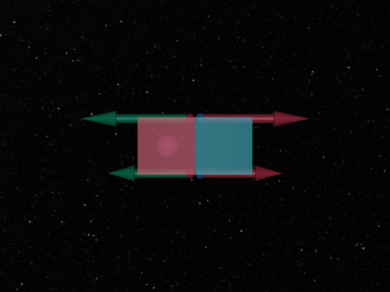

# Runtime Script

!!! abstract

    While the [Generate Script](generate-script.md) builds the world, the **Runtime Script** defines its execution. This is where you apply forces, execute control logic, and decide what data is worth saving.

    The beauty of Mojo is that you don't need to manage the low-level MuJoCo physics state manually; the [`RuntimeManager`][mujoco_mojo.runtime.runtime_manager.RuntimeManager] handles the heavy lifting, ensuring your simulation is stable and your telemetry is perfectly synchronized.

    <figure markdown="span">
        { width="50%" height="auto" }
        <figcaption>The visual result of the completed runtime script: Two spring forces act between the sphere site pairs defined in the generate step. The action-reaction forces are displayed. The boxes translate away from one another while rotating due to mismatched the unequal spring force.</figcaption>
    </figure>

!!! info "Suggested Reading:  Mojo Reloaded"

    After a brief skim of this guide, you may want to take a look at [the guide](../features/reloaded/reloaded.md) on using **Mojo Reloaded** to accelerate your prototyping.

---

## The Runtime Function Contract

Like the generate script, the runtime script follows a strict protocol. It receives the [`MojoModel`][mujoco_mojo.mojo_model.MojoModel] (populated with your `user_data` and `DepPath` objects remapped), the [`RuntimeManager`][mujoco_mojo.runtime.runtime_manager.RuntimeManager] (your primary interface), and the standard MuJoCo model/data objects.

???+ example "Example: MojoRuntime Handle"

    ``` python
    --8<-- "src/mujoco_mojo/examples/boxes_and_springs/simulation.py:runtime-handle"
    ```

---

## The RuntimeManager (`rm`)

The [`RuntimeManager`][mujoco_mojo.runtime.runtime_manager.RuntimeManager] is the orchestrator of your simulation. It is recommended to use it as a context manager (`with runtime_manager as rm:`). This ensures that the results database is properly opened, the clocks are synchronized, and all resources are cleaned up when the trial finishes.

???+ tip "Tip: No Need to Pass `rm` Around"

    While inside the `with runtime_manager as rm:` block, `rm` is also available ambiently. Methods like `register_to_rm()` and `request()` will automatically find the active `RuntimeManager`/[`SignalManager`][mujoco_mojo.runtime.signal_manager.SignalManager] if you don't pass one explicitly, e.g. `spring_force.register_to_rm()` instead of `spring_force.register_to_rm(rm)`. This means helper functions like `add_spring_force()` in the `Handoff` class don't need to accept `rm` as a parameter at all, so long as they're called from within the `with` block.

### Defining Loads

This is where the `Handoff` pattern pays off! Since we packed our site references into `user_data` during generation, we can now easily apply complex forces and torques without searching through the MuJoCo model for IDs.

Mojo provides high-level force abstractions like [`PointToPointForce`][mujoco_mojo.runtime.load.PointToPointForce], which automatically handles the math for things like compression springs or hydraulic actuators. When providing reaction sites located on other bodies, the runtime manager also calculates the correct action-reaction forces to apply.

???+ example "Example: Applying Custom Forces"

    ``` python
    --8<-- "src/mujoco_mojo/examples/boxes_and_springs/simulation.py:forces"
    ```

???+ question "Available Load Types"

    <div class="grid cards" markdown>

    - [`GeneralLoad`][mujoco_mojo.runtime.load.GeneralLoad]

        ---

        **6-DOF force and torque**. Defines full spatial dynamics in either a relative frame or local to a site.

        > Think of it as a [`VectorForce`][mujoco_mojo.runtime.load.VectorForce] and [`VectorTorque`][mujoco_mojo.runtime.load.VectorTorque] combined into one robust plugin.

    - [`PointToPointForce`][mujoco_mojo.runtime.load.PointToPointForce]

        ---

        Acts along the **direct line of sight** between two sites.

        > Perfect for modeling linear springs, dampers, or hydraulic actuators where the force vector changes as the bodies move.

    - [`ScalarForce`][mujoco_mojo.runtime.load.ScalarForce]

        ---

        A **1-DOF** force applied strictly along the local **X-axis** of the action site.

        > Ideal for simple directional thrust or piston logic.

    - [`ScalarTorque`][mujoco_mojo.runtime.load.ScalarTorque]

        ---

        The rotational equivalent of a ScalarForce. Defines a **1-DOF** torque applied along the local **X-axis** of the action site.

        > Great for modeling a torsional spring, friction brakes, or revolute joint motor torques.

    - [`VectorForce`][mujoco_mojo.runtime.load.VectorForce]

        ---

        A **3-DOF** force vector. Can be defined relative to a site's orientation or anchored directly to the **world frame** for global forces.

        > Can be used to model buoyancy (acting at CG) or simplified magnetic attraction between two bodies.

    - [`VectorTorque`][mujoco_mojo.runtime.load.VectorTorque]

        ---

        A **3-DOF** torque vector. Similar to the VectorForce, it allows for complex rotational moments defined relative to a site or the global world frame.

        > Use it to model a reaction wheel or 3D magnetic dipole moments.

    - [`JointFriction`][mujoco_mojo.runtime.load.JointFriction]

        ---

        **Friction in a hinge, slide or ball joint**, with the formulation you pick: dry, viscous, both together, Stribeck or Karnopp.

        > Good for brake pads, grease-lubricated joints, cable friction and clutch stick-slip. `JointFriction.karnopp` uses the joint's actual bearing load as its normal force.

    - [`ActuatorControl`][mujoco_mojo.runtime.load.ActuatorControl]

        ---

        **Drives an actuator's control input** every timestep. Give it a `control_func` for any control law, or use `ActuatorControl.constant` for a set point you can change during the run.

        > Use it to hold a servo at a commanded angle or to run a motor from a controller. The [berthing example](../examples/berthing/introduction.md) drives each joint of its arm this way.

    </div>

### Physics Stepping

Forget about the difference between `mj_step` and `mj_forward`. Just call `rm.step()`! This method handles:

- Advancing the physics.
- Updating custom Mojo force plugins.
- Flushing telemetry to the [`SignalManager`][mujoco_mojo.runtime.signal_manager.SignalManager] and recording videos.
- Managing the internal simulation clock for real-time visualization.

---

## Request-Based Telemetry

Mojo uses a **"Request"** pattern for data logging. Instead of manually creating buffers or writing to CSVs, you simply tell the model what you are interested in.

???+ tip "Tip: Zero-Logic Logging"

    The `.request()` method is available on select Mojo objects. It tells the [`SignalManager`][mujoco_mojo.runtime.signal_manager.SignalManager] to automatically capture the requested signals for the duration of the trial. You can specify which signals are of interest to you (like if you are interested in a body's energy but not momentum).

    A value Mojo does not work out for you can be recorded too: your runtime calculates it and posts it with [`SignalManager.post()`][mujoco_mojo.runtime.signal_manager.SignalManager.post]. The [Custom Signals](../features/custom-signals/custom-signals.md) guide shows how.

???+ example "Example: Telemetry Requests"

    ``` python
    --8<-- "src/mujoco_mojo/examples/boxes_and_springs/simulation.py:requests"
    ```

---

## Video Recording

If you need visual proof of your simulation (or you just need something for a slide deck), the [`VideoRecorder`][mujoco_mojo.runtime.video_recorder.VideoRecorder] plugin provides a method to produce high-fidelity MP4s or gifs. They integrate directly with the [`RuntimeManager`][mujoco_mojo.runtime.runtime_manager.RuntimeManager] and use the named cameras defined in your generator.

???+ tip "Tip: Load Debugging"

    The `VideoRecorder` can automatically overlay custom force vectors (like your spring forces) directly onto the video frames, making it an invaluable tool for debugging.

???+ example "Example: Video Setup"

    ``` python
    --8<-- "src/mujoco_mojo/examples/boxes_and_springs/simulation.py:video"
    ```

---

## The Physics Loop

The heart of the script is the humble `while` or `for` loop. Because `rm.step()` handles all the housekeeping, your loop stays remarkably clean. All you need to do is provide a way to break out of the loop (i.e., when time passes a certain point or a force reaches a magnitude).

When the context manager for `rm` is over, all your requested telemetry and videos will be recorded!

???+ example "Example: Stepping"

    ``` python
    --8<-- "src/mujoco_mojo/examples/boxes_and_springs/simulation.py:stepping"
    ```

---

!!! success

    You've now mastered the "Mojo Way" of building and running simulations!

    With your **Generator** and **Runtime** scripts ready, the next step is to learn how to scale these up into massive Monte Carlo jobs using the [Job Runner](running-jobs/running-jobs.md).

??? example "Example: Full Runtime Script"

    ``` python
    --8<-- "src/mujoco_mojo/examples/boxes_and_springs/simulation.py:runtime"
    ```
